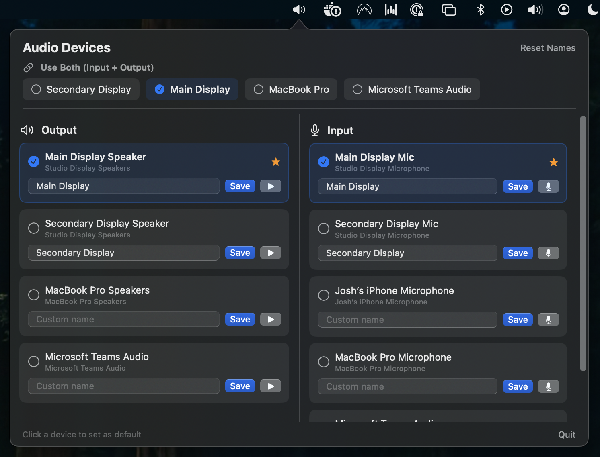
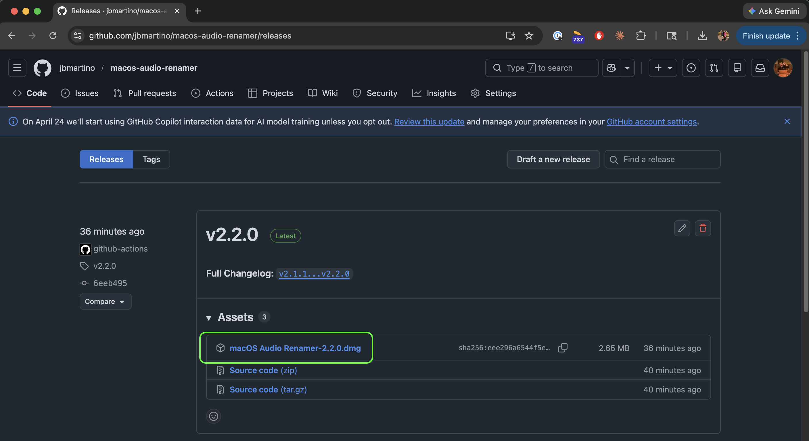
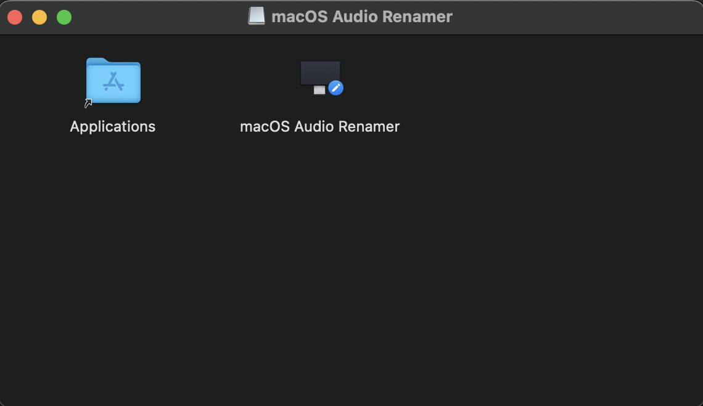

# macOS Audio Renamer

A lightweight macOS menu bar app for managing and renaming audio devices.



## Origin

This project was originally inspired by the challenge of using multiple Apple Studio Displays that share the same name with no native way to set a custom name. This made joining meetings a nightmare.

## Features

- **Native glass menu** — a compact menu bar menu (Liquid Glass on macOS 26) that closes when you click away
- **Quick switching** — the menu shows your current **Output** and **Input**; hover either to pick another device. Choosing a speaker switches to the same device's mic automatically (can be turned off).
- **One name per device** — rename a device once and the name applies to both its speaker and mic (e.g., "Studio Display" → "Main Display"). Name them separately in Settings if you want.
- **Paired device grouping** — speaker + mic pairs are linked for devices that share a name stem (Studio Displays, MacBook Pro, AirPods, etc.)
- **Name backup** — export your names to a file and import them on another Mac (Settings › Names)
- **Open at login** — one switch in Settings (the app asks once after install or update)
- **Auto-restore** — your preferred device is automatically retained when reconnected
- **Device testing** — in Settings, play a test chime through any speaker or watch a live mic level meter

## Install

### Download

1. Download the latest `.dmg` from [Releases](https://github.com/jbmartino/macos-audio-renamer/releases)

2. Open the DMG from `~/Downloads` and drag **macOS Audio Renamer** to Applications

3. Launch macOS Audio Renamer from Applications

### Build from source

Requires macOS 14+ and Swift 5.9+.

```bash
git clone https://github.com/jbmartino/macos-audio-renamer.git
cd macos-audio-renamer
swift build
.build/debug/MacOSAudioRenamer
```

## Tests

Run the standalone test script (no Xcode required):

```bash
swift Tests/run_tests.swift
```

On machines with Xcode installed, you can also use the SPM test target:

```bash
swift test
```

## Usage

1. Click the speaker icon in the menu bar
2. **Output ▸** — hover and click a device to make it your output (by default its mic becomes your input too)
3. **Input ▸** — choose a different microphone; the pencil on either row renames the current device
4. **Settings… (⌘,)** — rename devices, name a speaker and mic separately (expand a device with the chevron), test speakers/mics, and toggle "Switch microphone with speaker"
5. **Check for Updates…** — updates also install automatically (release builds only)
6. **Open at login** — the app offers this the first time it runs from Applications; change it any time in Settings

## How it works

Devices with unique hardware serials embedded in their CoreAudio UID (like Apple Studio Displays — e.g., `A1498802E` vs `C2210802E`) are identified and paired automatically, even when macOS gives them identical names.

For built-in devices (MacBook Pro, AirPods) and virtual devices (Microsoft Teams Audio), pairing is done by matching the device name stem after stripping suffixes like "Speakers" and "Microphone".

## Requirements

- macOS 14 (Sonoma) or later
- No Apple Developer account needed for personal use

## Support me

If you found this useful, consider supporting me!

[](https://ko-fi.com/jbmartino)
